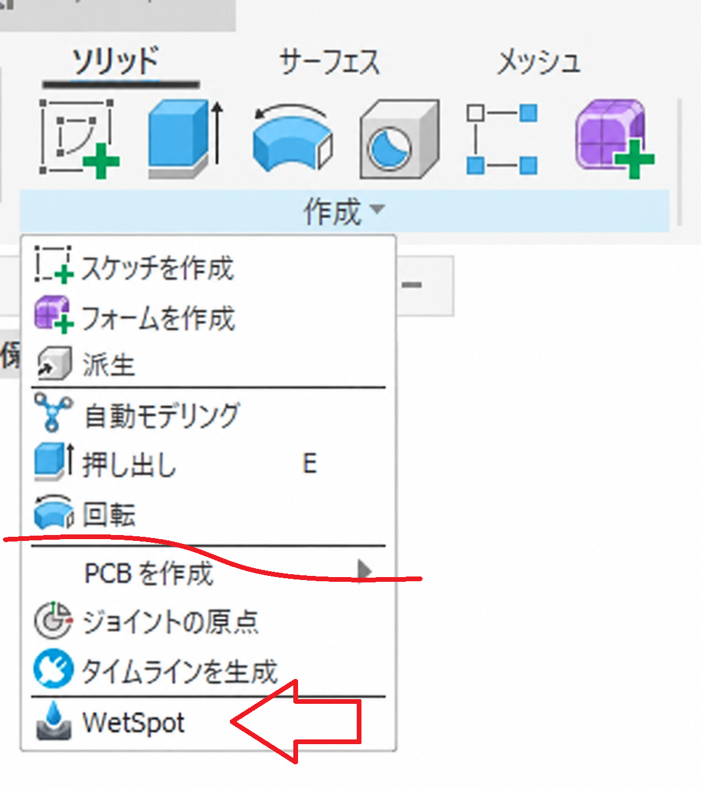

# Fusion_WetSpot

This is an add-in for Autodesk Fusion that analyzes the water pools (wet spots) that form when water is poured onto the selected solid bodies from a specified gravity direction, and creates them as water solid bodies.

It can be used to check where water collects on molded parts, or to decide where to put drain holes.

**The generated shapes are approximations computed on a grid.** Please read "Notes" before use.

---

## Installation

1. Quit Autodesk Fusion.
2. Download and extract the zip file.
3. Run `installer\install_Win.cmd` in the extracted folder.
4. Follow the on-screen instructions and enter `Y`.
5. The "WetSpot" folder is copied to `%APPDATA%\Autodesk\Autodesk Fusion 360\API\AddIns\WetSpot`, and the folder opens in Explorer.

Once Fusion starts, the add-in is ready to use. No further registration is needed.

To uninstall, delete the copied "WetSpot" folder.

---

## Usage

1. Open a design in Fusion and run **WetSpot** from the "SOLID" tab → "CREATE" panel.

   

2. When the dialog opens, the visible solid bodies are selected automatically. Add or remove bodies to analyze as needed.

3. If needed, specify the gravity direction with a construction axis, sketch line, or linear edge. The default is the **-Z direction**. Use "Reverse direction" to flip it. An arrow shows the direction while the dialog is open.

4. Set the analysis mode and options (see the table below).

5. Click **OK** to run the analysis and create the water pool solid bodies. When it finishes, the volume, maximum depth, and surface area of each pool are shown.

### Dialog Settings

| Item | Default | Description |
| --- | --- | --- |
| Bodies to analyze | Visible solids | Solid bodies to analyze (multiple allowed) |
| Gravity direction | -Z | One construction axis, sketch line, or linear edge |
| Reverse direction | OFF | Reverses the gravity direction |
| Analysis mode | Accurate | **Accurate**: Also finds water trapped under overhangs. **Fast**: Uses only the height seen from the gravity direction. Not recommended. |
| Output drain hole locations | OFF | Creates sketch points where the water can drain out completely |
| Live preview | OFF | Shows the water surface in yellow while the dialog is open |

### Output

- One solid body per pool is created in the **Wet Spot** component. Bodies are named `Wet Spot_01_<volume>mm^3` and get a water material.
- If "Output drain hole locations" is ON, the drain points are created in the sketch **Wet Spot Drain Points**.
- When you run the command again, the pools and drain points from the previous run are deleted and replaced with the new results.
- A breakdown of the processing time is printed to the "Text Commands" window.

---

## How It Works

The target bodies are converted to meshes, and the solid intervals of each cell are found on an XY grid seen from the gravity direction (200 divisions along the longest side). The Priority-Flood method then finds the lowest water level at which water can drain to the outside, and everything below that level is detected as a pool.

- **Fast mode**: Analyzes a 2.5D height field that uses only the top surface of each cell.
- **Accurate mode**: Analyzes a graph whose nodes are the empty intervals of each cell, so it can handle areas under overhangs and side holes.

A prism is built from the outline of each detected pool, and the source bodies are subtracted from it to create the water solid.

### About numpy

The Python bundled with Fusion does not include numpy. On the first run, numpy is downloaded automatically into the `packages` folder inside the add-in folder to speed up the calculation. This needs an internet connection. If the download fails, the calculation continues in pure Python (the results are the same, but it takes longer).

The numpy download is for Windows (win_amd64) only, so Windows is recommended.

---

## Notes

- **The resulting shapes are grid approximations.** Narrow grooves, steep steps, and fine details may not be reproduced accurately. Check the shapes after they are created.
- Sealed cavities with no path to the outside are not filled with water.
- Only solid bodies are supported. Surface and mesh bodies are not supported.
- Pool bodies created by WetSpot are excluded from the analysis.
- In parametric designs (with history), pool bodies are created in the Base Feature **Wet Spot Pools**.
- Windows only.

---

## Supported Languages

The add-in is shown in the following languages, matching Fusion's display language:

English, Japanese, German, Spanish, French, Italian, Korean, Polish, Portuguese (Brazil), Chinese (Simplified), Turkish

---

## Environment

- Autodesk Fusion Ver2706.1.14
- Windows11 64bit Home

---

## License

- Apache License 2.0

---

# *** 以下は日本語です。***

選択したソリッドボディに、指定した重力方向から水をかけたときにできる「水たまり」を解析し、水のソリッドボディとして生成する Autodesk Fusion 用アドインです。

成形品の水たまりの確認や、水抜き穴の位置検討に使えます。

**生成される形状は格子による近似計算の結果です。** 使用前に「注意事項」をご確認ください。

---

## インストール

1. Autodesk Fusion を終了してください。
2. zip ファイルをダウンロードし、展開してください。
3. 展開したフォルダ内の `installer\install_Win.cmd` を実行してください。
4. 画面の指示に従い、`Y` を入力してください。
5. 「WetSpot」フォルダが `%APPDATA%\Autodesk\Autodesk Fusion 360\API\AddIns\WetSpot` にコピーされ、エクスプローラーで開きます。

Fusion を起動すると、そのまま使えます。アドインの登録は不要です。

アンインストールするには、コピーされた「WetSpot」フォルダを削除してください。

---

## 使用法

1. Fusion でデザインを開き、「ソリッド」タブの「作成」パネルから **WetSpot** を実行します。

   

2. ダイアログを開くと、表示中のソリッドボディが自動で選択されます。解析対象は必要に応じて追加・解除してください。

3. 必要であれば、構築軸・スケッチ線・直線エッジのいずれかで重力方向を指定します。初期値は **-Z 方向** です。向きを逆にするには「方向反転」を使います。ダイアログを開いている間は、矢印で方向を確認できます。

4. 解析モードとオプションを設定します（下表参照）。

5. **OK** を押すと解析が実行され、水たまりのソリッドボディが作成されます。完了すると、各水たまりの体積・最大水深・水面積が表示されます。

### ダイアログの設定項目

| 項目 | 初期値 | 内容 |
| --- | --- | --- |
| 解析ボディ | 表示中のソリッド | 解析対象のソリッドボディ（複数選択可） |
| 重力方向 | -Z | 構築軸、スケッチ線、直線エッジのいずれか1つ |
| 方向反転 | OFF | 重力方向の向きを逆にする |
| 解析モード | 正確 | **正確**：庇（オーバーハング）の下にたまる水も検出します。 **高速**：重力方向から見た高さ情報だけで解析します。推奨しません。 |
| 水抜き穴位置出力 | OFF | 水を残さず抜けるための位置を、スケッチ点として出力します |
| ライブプレビュー | OFF | ダイアログを開いている間、水面を黄色で表示します |

### 生成されるもの

- **Wet Spot** コンポーネント内に、水たまりごとにソリッドボディを1つ作成します。ボディ名は `Wet Spot_01_<体積>mm^3` の形式で、水のマテリアルが設定されます。
- 「水抜き穴位置出力」が ON の場合、スケッチ **Wet Spot Drain Points** に水抜き点を作成します。
- 再実行すると、前回の水たまりと水抜き点は削除され、新しい結果に置き換えられます。
- 処理時間の内訳は「テキストコマンド」ウィンドウに出力されます。

---

## 仕組み

対象ボディをメッシュ化し、重力方向から見た XY 格子（最長辺を 200 分割）上で、各セルのソリッド区間を求めます。続いて Priority-Flood 法で、外部へ排水できる最も低い水位を求め、それより低い部分を水たまりとして検出します。

- **高速モード**：各セルの最上面だけを使う 2.5D の高さ場で解析します。
- **正確モード**：各セルの空間区間をノードとするグラフで解析するため、庇の下や横穴も扱えます。

検出した水たまりの輪郭からプリズムを作り、元ボディを差し引いて水のソリッドを作成します。

### numpy について

Fusion 同梱の Python には numpy が含まれません。そのため初回実行時に numpy を自動で取得し、アドインフォルダ内の `packages` フォルダに配置して計算を高速化します。取得にはインターネット接続が必要です。取得に失敗した場合は、純 Python の処理で計算を続けます（結果は同じですが、処理時間は長くなります）。

numpy は Windows 版（win_amd64）のみ取得するため、Windows を推奨します。

---

## 注意事項

- **出来上がりの形状は格子による近似です。** 細い溝、急な段差、細かな凹凸は正確に再現されない場合があります。生成後に形状を確認してください。
- 外部へ通じる経路がない密閉された空洞には、水は入りません。
- 対象はソリッドボディのみです。サーフェスボディとメッシュボディには対応していません。
- WetSpot が生成した水たまりボディは、解析対象から除外されます。
- パラメトリック（履歴あり）デザインでは、水たまりボディは Base Feature **Wet Spot Pools** 内に作成されます。
- Windows のみ対応です。

---

## 対応言語

Fusion の表示言語に合わせて、以下の言語で表示されます。

英語、日本語、ドイツ語、スペイン語、フランス語、イタリア語、韓国語、ポーランド語、ポルトガル語（ブラジル）、中国語（簡体字）、トルコ語

---

## 動作環境

- Autodesk Fusion Ver2706.1.14
- Windows11 64bit Home

---

## ライセンス

- Apache License 2.0

---

## 謝辞

- [日本語フォーラム](https://forums.autodesk.com/t5/fusion-ri-ben-yuforamu/bd-p/fusion-forum-ja)の皆さん、ありがとうございます。
